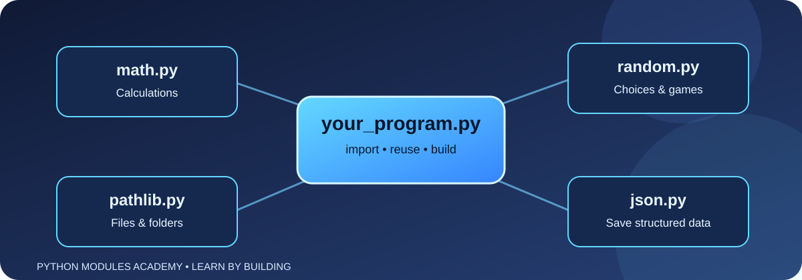
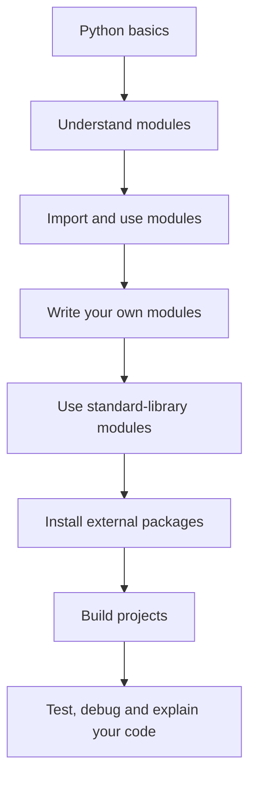

# Python Modules Academy

A practical, beginner-friendly course about Python modules, packages, and libraries. Learn the ideas, inspect diagrams, write small programs, and finish with real projects.




> **Goal:** understand how Python code is organised and learn to choose the right module for a task—not just copy code without understanding it.

## Start here

1. [What is a module?](lessons/01-what-is-a-module.md)
2. [Importing modules](lessons/02-importing-modules.md)
3. [Create your own modules](lessons/03-create-your-own-module.md)
4. [Python's standard library](lessons/04-standard-library.md)
5. [Install third-party packages with pip](lessons/05-packages-and-pip.md)
6. [Errors, help, and documentation](lessons/06-debugging-and-docs.md)
7. [Project: Nearby Wi-Fi Network Viewer](projects/wifi-network-viewer.md)
8. [Project: File Organiser](projects/file-organiser.md)
9. [Practice challenges](challenges/README.md)

## Learning roadmap



## What is inside?

- **Detailed lessons:** plain-English explanations, examples, common mistakes, and practice tasks.
- **Diagrams:** Mermaid diagrams show how imports and projects fit together. GitHub renders these in Markdown.
- **Real projects:** a read-only viewer for nearby Wi-Fi networks, a file organiser, and more.
- **Safe learning:** projects inspect information your own device can normally see. They do not crack passwords, bypass network security, disconnect devices, or access networks without permission.

## How to use this course

1. Open the first lesson and read it from top to bottom.
2. Type the examples yourself instead of only copying them.
3. Run each program in VS Code or a terminal with Python installed.
4. Change one thing at a time and predict what will happen.
5. Complete the practice task before moving on.

## Requirements

- Python 3.10 or newer is recommended.
- A code editor such as VS Code.
- Internet access is needed only for installing third-party packages or reading online documentation. The first lessons use Python's built-in tools.

Check Python in a terminal:

```bash
python --version
```

On some systems, use `python3 --version`.

## Suggested folder structure

```text
python/
├── README.md
├── lessons/
│   ├── 01-what-is-a-module.md
│   ├── 02-importing-modules.md
│   ├── 03-create-your-own-module.md
│   ├── 04-standard-library.md
│   ├── 05-packages-and-pip.md
│   └── 06-debugging-and-docs.md
├── projects/
│   ├── wifi-network-viewer.md
│   └── file-organiser.md
└── challenges/
    └── README.md
```

## Learning principle

A module is a tool, not magic. Learn what it does, what data it expects, what it returns, and what errors it can raise. Then use it to solve a problem.

## Contributing

Found a mistake or have a useful beginner exercise? Open an issue or submit a pull request with a clear explanation and tested examples.

## License

This educational material may be reused and adapted under the MIT License. Add a standard MIT `LICENSE` file if you want the repository to include the full license text.
