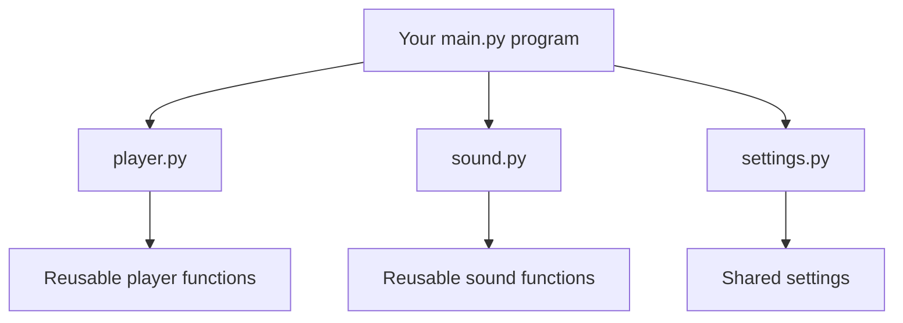

# Lesson 1: What is a Python module?


## The big idea

A **module** is a Python file that contains code you can reuse. It may contain functions, variables, classes, and other instructions.

Imagine you are building a game. Instead of putting every feature into one enormous file, you could place sound functions in `sound.py`, player functions in `player.py`, and settings in `settings.py`. Each file becomes a small, focused part of the program.

Python also comes with modules, such as `math`, `random`, `pathlib`, and `json`.

## Diagram: one program, several modules



The arrows mean that one part of the program can import and use another part.

## Your first module example

Create a file named `greetings.py`:

```python
def say_hello(name):
    return f"Hello, {name}!"
```

Now create `main.py` in the same folder:

```python
import greetings

message = greetings.say_hello("Alex")
print(message)
```

Run `main.py`. The output is:

```text
Hello, Alex!
```

### What happened?

1. `import greetings` makes the module available to this program.
2. `greetings.say_hello` means “use the function called `say_hello` inside `greetings`.”
3. The string `"Alex"` is passed into the function as the `name` argument.
4. The function returns a string, and `print()` displays it.

The dot in `greetings.say_hello` tells Python which module the name belongs to.

## Module vs package vs library

- **Module:** usually one Python file, such as `greetings.py`.
- **Package:** a folder that groups related Python modules.
- **Library:** a general term for reusable code. A library may contain many packages and modules.

People sometimes use “library” and “package” loosely, but knowing the distinction helps when reading documentation.

## Why use modules?

- **Reuse:** write a function once and import it elsewhere.
- **Organisation:** keep related code together.
- **Testing:** smaller pieces are easier to check.
- **Teamwork:** different people can work on different files.
- **Clarity:** a file named `file_tools.py` communicates its purpose better than one huge file.

## Quick experiment

Add this to `greetings.py`:

```python
def add(a, b):
    return a + b
```

Then call it from `main.py` with `greetings.add(7, 5)`.

**Challenge:** create a module named `score.py` with a function that accepts a player's score and returns a message containing it.

## Common mistake

If Python says `ModuleNotFoundError: No module named 'greetings'`, check that the file is named exactly `greetings.py` and that `main.py` and `greetings.py` are in the same folder for this example.
