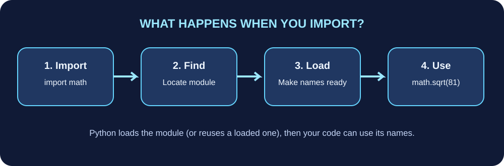
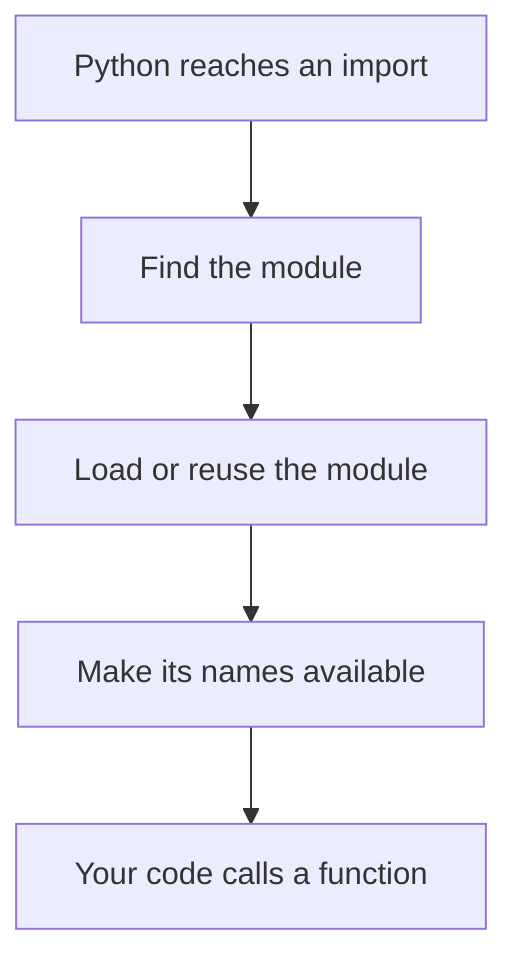

# Lesson 2: Importing modules



An **import** tells Python that you want to use code defined somewhere else.

## Pattern 1: import the whole module

```python
import math

print(math.sqrt(81))
print(math.pi)
```

Output:

```text
9.0
3.141592653589793
```

The `math` module supplies mathematical constants and functions. Writing `math.sqrt` makes it clear where `sqrt` comes from.

## Pattern 2: import one name

```python
from math import sqrt

print(sqrt(81))
```

This lets you use `sqrt` directly. It is handy for a small number of clear imports, but in a large file it can be less obvious where a name came from.

## Pattern 3: use an alias

```python
import statistics as stats

scores = [70, 85, 90, 95]
print(stats.mean(scores))
```

An alias gives the module a shorter local name. Use familiar aliases, and avoid inventing confusing abbreviations.

## How importing works



Python searches for modules using its import system and search path. The current project folder is commonly part of that path, but imports can fail if files are misplaced or named incorrectly.

## Which pattern should you choose?

- Prefer `import module_name` when you want clear ownership of names.
- Use `from module_name import name` when the imported name is specific and unambiguous.
- Use `as` for standard, widely recognised aliases or to avoid a naming conflict.
- Avoid `from module_name import *`. It can fill your file with names and make it difficult to know where they came from.

## A useful built-in module: random

```python
import random

items = ["Python", "Robotics", "Games"]
choice = random.choice(items)
print(choice)
```

The selected item can change on each run. This is useful for simple games, quizzes, and simulations. Do not use `random` for security-sensitive tokens or passwords; Python provides the `secrets` module for security-oriented randomness.

## Try it

1. Import `datetime` and print the current date.
2. Import `sqrt` from `math` and calculate the square root of 144.
3. Import `statistics` as `stats` and calculate the mean of `[4, 8, 12]`.

## Troubleshooting checklist

- Is the module name spelled correctly?
- Did you install an external package into the same Python environment that runs your program?
- Is there a local file with the same name as a standard module, such as `random.py` or `json.py`? Rename it if so.
- Are you running Python from the folder you expect?
