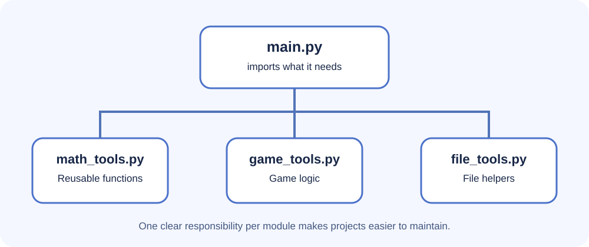
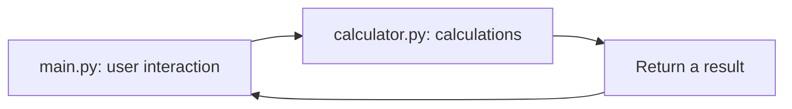

# Lesson 3: Create your own modules and packages



Once you understand imports, you can design your own reusable code.

## Build a tiny calculator module

Create this structure:

```text
calculator_project/
├── main.py
└── calculator.py
```

In `calculator.py`:

```python
def add(a, b):
    return a + b

def subtract(a, b):
    return a - b

def multiply(a, b):
    return a * b
```

In `main.py`:

```python
import calculator

print(calculator.add(12, 8))
print(calculator.subtract(12, 8))
print(calculator.multiply(12, 8))
```

Keeping the functions in `calculator.py` means another program can reuse them.

## Diagram: splitting responsibilities



Each file has one main job. This is a simple form of separation of concerns.

## What is a package?

A package groups related modules into a directory. For example:

```text
study_tools/
├── __init__.py
├── grades.py
└── timetable.py
```

- `grades.py` could contain functions for calculating averages.
- `timetable.py` could contain functions for organising lessons.
- `__init__.py` can mark a directory as a regular package and may define a small public interface. Modern Python also supports namespace packages without it, but using it is clear for a beginner project.

A package is imported by its package/module path, for example `from study_tools import grades`, when the package is on Python's import path.

## Protect code that should only run when a file is executed

A common pattern is:

```python
def main():
    print("This program is running.")

if __name__ == "__main__":
    main()
```

When Python runs this file directly, `__name__` is set to `"__main__"`. When another file imports it, the condition is false, so `main()` does not run automatically.

This prevents a module from unexpectedly starting a whole program just because another file imported it.

## Design tips

1. Give a module one clear responsibility.
2. Use descriptive lowercase filenames, such as `grade_tools.py`.
3. Keep reusable functions separate from interactive input and output when practical.
4. Avoid circular imports, where module A imports B while B imports A.
5. Document functions with docstrings.

Example:

```python
def average(scores):
    """Return the arithmetic mean of a non-empty list of scores."""
    if not scores:
        raise ValueError("scores must not be empty")
    return sum(scores) / len(scores)
```

## Challenge

Create `temperature.py` with functions to convert Celsius to Fahrenheit and Fahrenheit to Celsius. Import those functions from `main.py` and test them with 0°C and 32°F.
