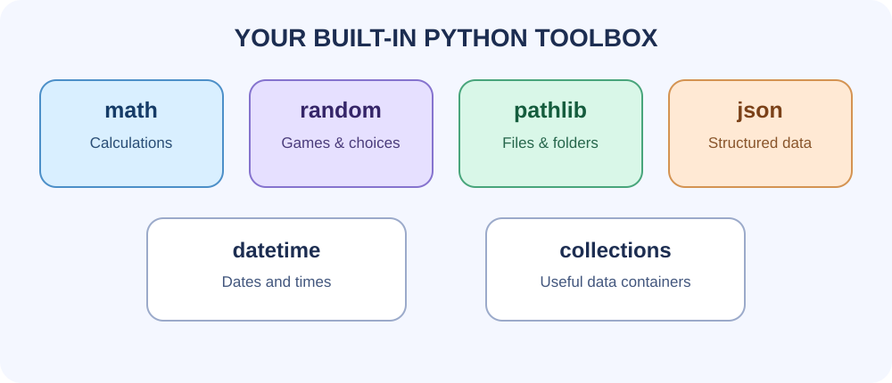
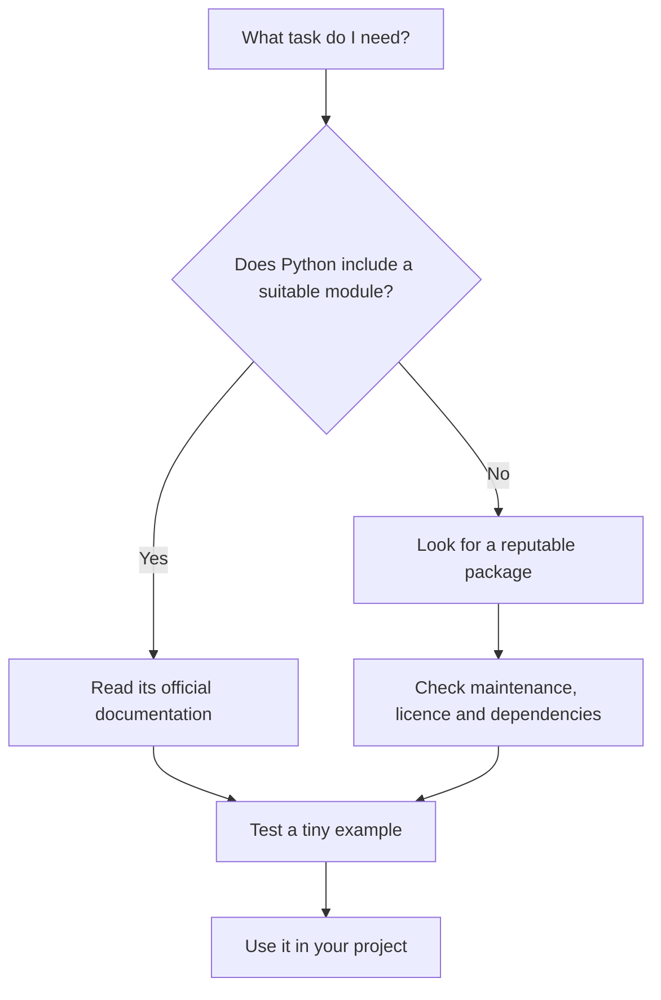

# Lesson 4: The Python standard library



The **standard library** is a collection of modules that comes with Python. Many useful tools are available without installing anything with pip.

## Modules worth learning

| Module | What it helps you do |
|---|---|
| `math` | Mathematical functions and constants |
| `random` | Random choices and simple simulations |
| `statistics` | Mean, median, and other statistics |
| `datetime` | Dates and times |
| `pathlib` | Work with file and folder paths |
| `json` | Read and write JSON data |
| `csv` | Read and write CSV tables |
| `collections` | Specialised containers such as counters |
| `re` | Pattern matching in text |
| `subprocess` | Run external programs |
| `logging` | Record program events and errors |
| `unittest` | Write automated tests |

## Example: count repeated words

```python
from collections import Counter

words = ["python", "modules", "python", "files", "python"]
counts = Counter(words)

print(counts["python"])
print(counts.most_common(2))
```

`Counter` counts how many times each value appears. This can help with word games, survey summaries, and simple data analysis.

## Example: save settings as JSON

```python
import json

settings = {
    "theme": "dark",
    "font_size": 16,
}

with open("settings.json", "w", encoding="utf-8") as file:
    json.dump(settings, file, indent=2)
```

This creates a readable JSON file in the current working directory. Be careful not to overwrite a file you need.

To load it again:

```python
import json

with open("settings.json", encoding="utf-8") as file:
    settings = json.load(file)

print(settings["theme"])
```

## Example: safer file paths with pathlib

```python
from pathlib import Path

folder = Path("notes")
folder.mkdir(exist_ok=True)

file_path = folder / "today.txt"
file_path.write_text("Practised Python modules.", encoding="utf-8")

print(file_path.read_text(encoding="utf-8"))
```

Using `Path` helps Python handle paths across operating systems. This example creates a folder and file in the program's working directory.

## How to choose a module



## Practice

Pick three modules from the table. For each one, write down:
- The problem it solves.
- One function or class it provides.
- A tiny example.
- One limitation or mistake to watch for.

Official reference: [Python Standard Library documentation](https://docs.python.org/3/library/).
