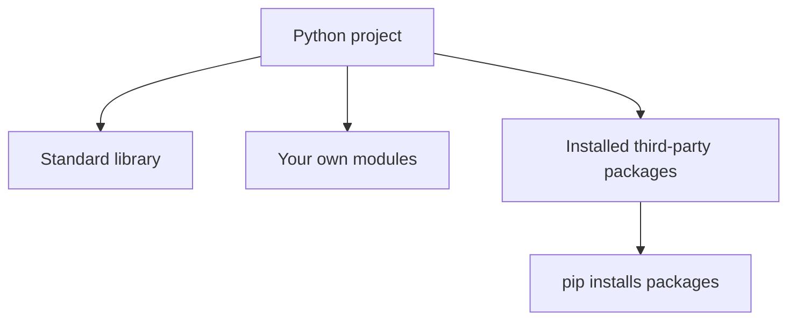

# Lesson 5: Third-party packages and pip


Python's standard library is useful, but developers also share packages that add more features. **pip** is the common installer for Python packages.

## Module, package, and pip



## Install a package

Create a virtual environment first. This keeps project dependencies separate from other projects.

On Windows:

```bash
python -m venv .venv
.venv\\Scripts\\activate
python -m pip install requests
```

On macOS or Linux:

```bash
python3 -m venv .venv
source .venv/bin/activate
python -m pip install requests
```

The exact activation command depends on your terminal. If activation is blocked by a system policy, use the appropriate documented activation method for your shell rather than changing security settings blindly.

## Use the package

```python
import requests

response = requests.get("https://example.com", timeout=10)
print(response.status_code)
```

This sends an HTTP request to a public example website. Network requests can fail or take time, so a timeout is important. Only send requests to services you are allowed to access.

## Record dependencies

A simple requirements file might contain:

```text
requests
```

Install the listed dependencies with:

```bash
python -m pip install -r requirements.txt
```

For reproducible applications, teams often pin and test specific versions rather than relying on whichever version is newest.

## Choose packages carefully

Before installing a package:
1. Read its documentation.
2. Check whether it is maintained and compatible with your Python version.
3. Review its licence and dependencies.
4. Install it in a virtual environment.
5. Avoid running unknown scripts with administrator privileges.

## Common problems

**`No module named requests`** — install the package using the same Python interpreter that runs your program: `python -m pip install requests`.

**The command `pip` is not found** — try `python -m pip` or `python3 -m pip`.

**It works in one terminal but not another** — check which interpreter and virtual environment each terminal is using.

Official guide: [Installing Python packages](https://packaging.python.org/en/latest/tutorials/installing-packages/).
