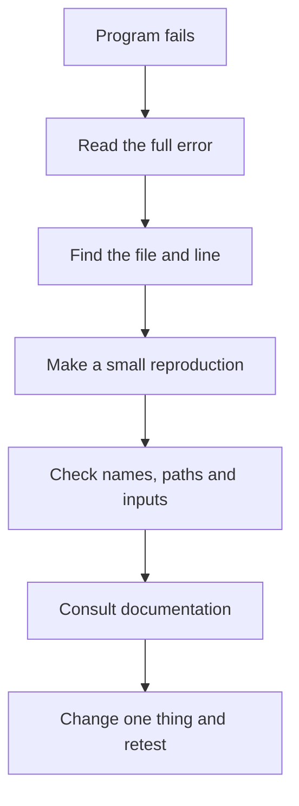

# Lesson 6: Debugging modules and reading documentation


Even experienced developers look things up. Good programmers learn how to investigate a problem instead of guessing.

## Ask Python for help

```python
import math

help(math)
print(dir(math))
print(math.sqrt.__doc__)
```

- `help()` displays documentation available to Python.
- `dir()` lists names available on an object or module.
- `__doc__` often contains a function's documentation string.

These tools are useful, but official documentation is usually easier to read for a full explanation.

## Read a traceback

A traceback shows the chain of calls leading to an error. Start at the bottom to find the exception type and message, then inspect the file and line number mentioned.

Example error:

```text
ModuleNotFoundError: No module named 'my_tools'
```

Investigate:
1. Does `my_tools.py` exist?
2. Is it in the expected project folder?
3. Is the filename accidentally `my_tools.py.txt`?
4. Did you run the correct Python interpreter?
5. Is another file or folder causing an import-name conflict?

## The import-name trap

Do not name your own files after standard modules you want to use. A file named `random.py` can shadow Python's `random` module. Names like `json.py`, `statistics.py`, and `requests.py` can also cause confusion if they conflict with imports.

If you rename a conflicting file, remove any matching local `__pycache__` files only when needed, then run the program again.

## Test your module

For a module with an `add` function:

```python
def add(a, b):
    return a + b
```

A simple test using the built-in `unittest` module:

```python
import unittest
from calculator import add

class CalculatorTests(unittest.TestCase):
    def test_add_positive_numbers(self):
        self.assertEqual(add(2, 3), 5)

    def test_add_negative_number(self):
        self.assertEqual(add(-2, 2), 0)

if __name__ == "__main__":
    unittest.main()
```

Save the test as `test_calculator.py` beside `calculator.py`, then run `python -m unittest`.

## Debugging flow



## Challenge

Create a module with two functions. Write at least three tests, including one edge case. Make one test fail on purpose, read the error, and fix the cause.
