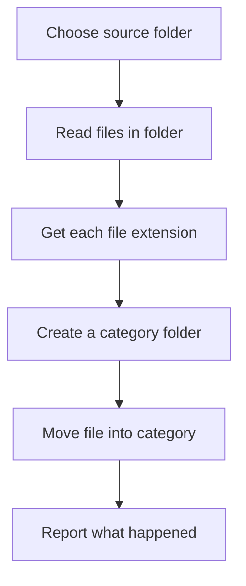

# Project: File Organiser

This project demonstrates how modules help automate a repetitive task. The program groups files in a folder by file extension.

**Safety first:** test on a temporary folder containing copies of files. The example moves files, so understand the destination before running it on important data.

## Diagram



## Code

Save as `organise_files.py`:

```python
from pathlib import Path
import shutil


def category_for(path):
    """Return a simple folder name based on a file's extension."""
    suffix = path.suffix.lower().lstrip(".")
    return suffix if suffix else "no_extension"


def organise(folder_name):
    folder = Path(folder_name).expanduser().resolve()

    if not folder.is_dir():
        raise NotADirectoryError(f"Not a folder: {folder}")

    for path in folder.iterdir():
        if not path.is_file():
            continue

        category = category_for(path)
        destination_folder = folder / category
        destination_folder.mkdir(exist_ok=True)
        destination = destination_folder / path.name

        # Do not overwrite an existing file.
        if destination.exists():
            print(f"Skipped because destination exists: {path.name}")
            continue

        shutil.move(str(path), str(destination))
        print(f"Moved {path.name} -> {category}/")


if __name__ == "__main__":
    target = input("Folder to organise (use a test folder first): ").strip()
    try:
        organise(target)
    except (OSError, shutil.Error) as error:
        print(f"Could not organise folder: {error}")
```

## Which modules are used?

- `pathlib` provides path objects and checks such as `is_file()` and `is_dir()`.
- `shutil` provides higher-level file operations, including moving files.
- `input()` asks the user which folder to organise.

## Improve it

- Add a dry-run mode that previews moves without changing anything.
- Add a confirmation step before moving files.
- Write tests for `category_for()`.
- Handle duplicate names by asking before skipping or choosing a safe new name.
