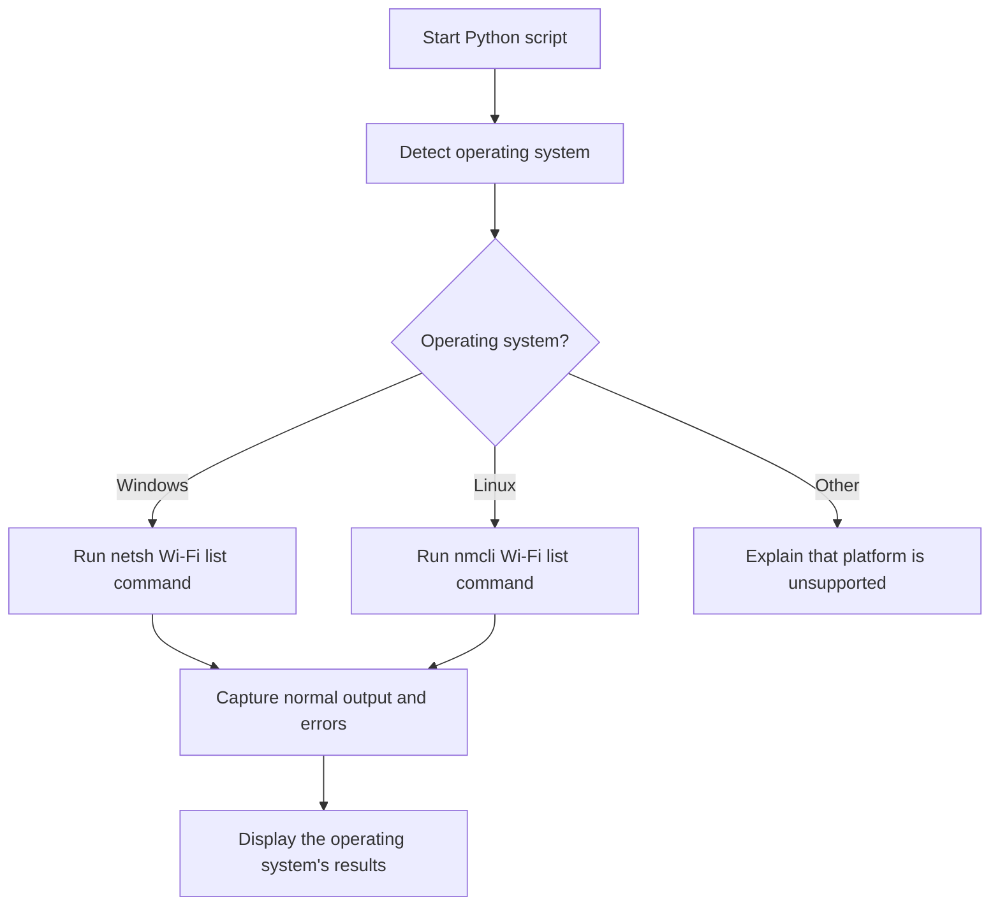

# Project: Nearby Wi-Fi Network Viewer

Build a small Python tool that asks your operating system to list Wi-Fi networks visible to your own device. This project demonstrates modules, subprocesses, platform differences, and error handling.

**Scope:** this is a read-only learning project. It does not connect to networks, reveal Wi-Fi passwords, bypass security, deauthenticate devices, or access other people's systems. Only inspect networks you are authorised to observe.

## What you will learn

- Importing standard-library modules.
- Using `subprocess` to call a system utility.
- Checking which operating system is running the program.
- Handling missing commands and failed scans.
- Separating platform-specific code into functions.

## Diagram



## The code

Save this as `wifi_viewer.py`:

```python
import platform
import subprocess


def scan_windows():
    """Ask Windows to list visible Wi-Fi networks."""
    return subprocess.run(
        ["netsh", "wlan", "show", "networks", "mode=bssid"],
        capture_output=True,
        text=True,
        timeout=20,
        check=False,
    )


def scan_linux():
    """Ask NetworkManager's nmcli tool to list visible Wi-Fi networks."""
    return subprocess.run(
        ["nmcli", "--terse", "--fields", "SSID,SIGNAL,SECURITY",
         "device", "wifi", "list"],
        capture_output=True,
        text=True,
        timeout=20,
        check=False,
    )


def main():
    system = platform.system()

    try:
        if system == "Windows":
            result = scan_windows()
        elif system == "Linux":
            result = scan_linux()
        else:
            print(
                f"This starter example does not support {system} yet. "
                "See the platform notes in the lesson."
            )
            return

        if result.returncode != 0:
            print("The Wi-Fi listing command did not succeed.")
            if result.stderr.strip():
                print(result.stderr.strip())
            print("Check that Wi-Fi is enabled and the required system tool exists.")
            return

        if result.stdout.strip():
            print("Wi-Fi scan results reported by your operating system:\n")
            print(result.stdout)
        else:
            print("No results were returned. Check Wi-Fi and permissions.")

    except FileNotFoundError:
        print("The required operating-system command was not found.")
    except subprocess.TimeoutExpired:
        print("The scan took too long. Try again when the device is ready.")
    except OSError as error:
        print(f"Could not run the Wi-Fi listing command: {error}")


if __name__ == "__main__":
    main()
```

## Run it

Open a terminal in the folder where you saved the file:

```bash
python wifi_viewer.py
```

On some systems the command is `python3 wifi_viewer.py`.

### What the imports do

- `platform` tells the script which operating system is running.
- `subprocess` runs a specific system utility and collects its output.
- `subprocess.run()` receives a list of command arguments. Using a list rather than building a shell command from user input avoids many shell-injection risks.
- `capture_output=True` collects normal output and error output.
- `text=True` makes output available as text.
- `timeout=20` prevents the program waiting indefinitely.
- `check=False` lets the program inspect the return code and display a beginner-friendly error.

## Platform notes

- **Windows:** `netsh wlan show networks mode=bssid` is a Windows command. The output can include SSIDs and radio details reported by Windows.
- **Linux:** `nmcli` is provided by NetworkManager. It may not be installed, or permission and Wi-Fi state may limit results.
- **macOS:** this starter version does not implement scanning. macOS command availability changes between releases; use Apple's supported system interfaces and documentation if extending it.

The results depend on your adapter, operating system, radio environment, and permissions. A network name may be hidden or blank. This script does not promise that every nearby network will appear.

## Make it more fun

1. Print a numbered list of network names rather than the raw output.
2. Add a menu explaining how to retry the scan.
3. Put Windows and Linux scanning functions in separate modules.
4. Write unit tests for the platform-selection logic by mocking the scan functions.
5. Create a diagram of the data moving from the operating system to the Python program.

**Important next step:** parsing raw command output is platform-specific. If you turn this into a larger app, keep each operating system's parser separate and test it using sample output. Do not store or publish network details collected from other people without permission.
